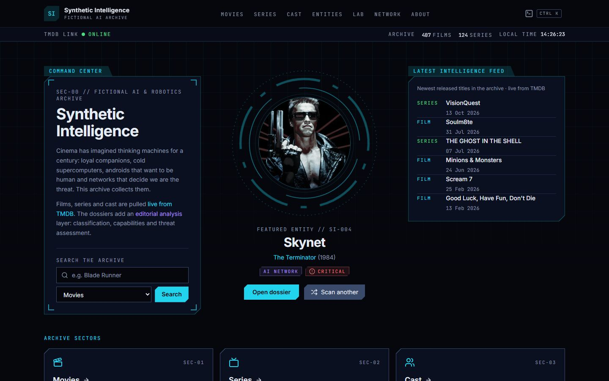
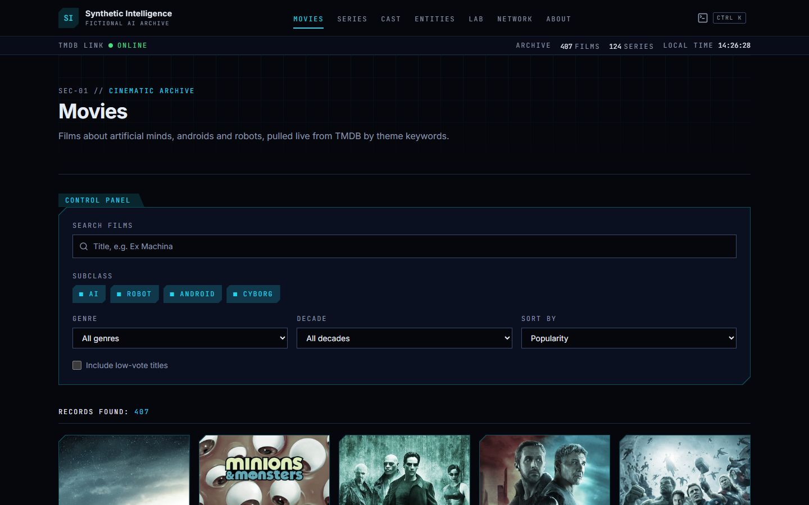
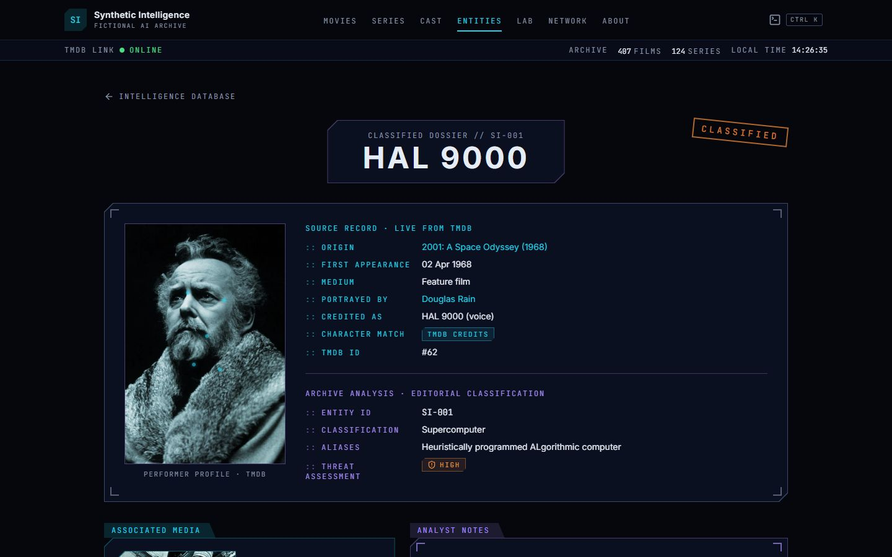
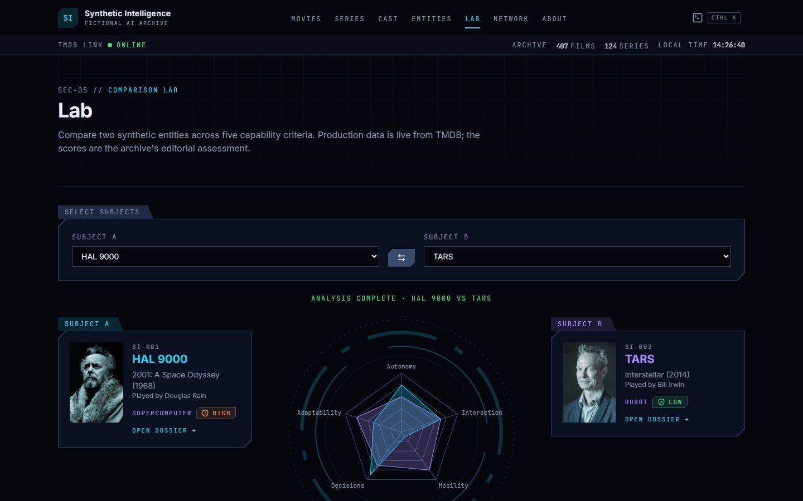
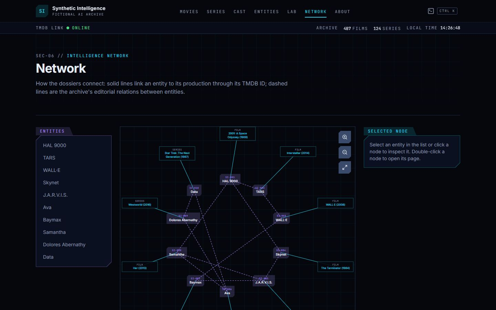
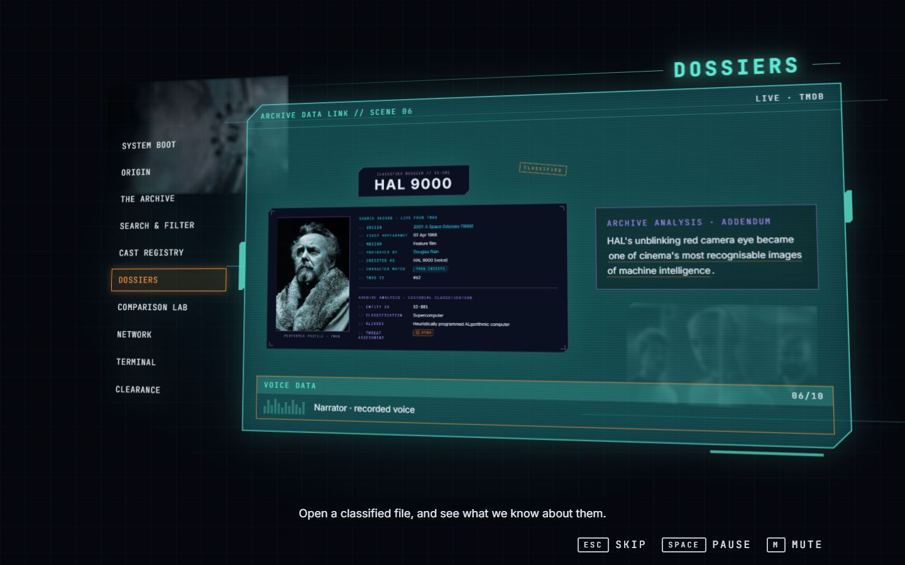
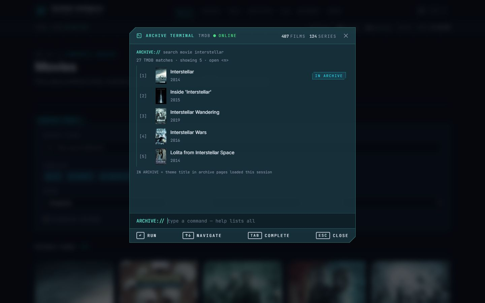
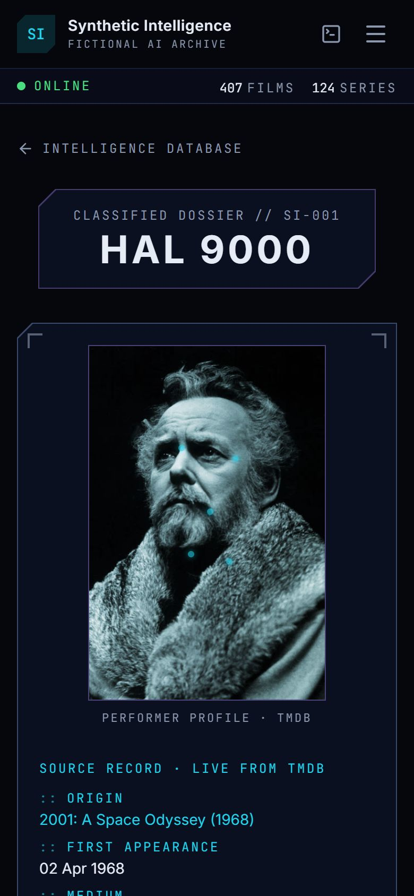

# Synthetic Intelligence — Fictional AI & Robotics Archive

An interactive wiki of the artificial intelligences, androids and robots of film and television.

**Live site:** **[synthetic-intelligence-khaki.vercel.app](https://synthetic-intelligence-khaki.vercel.app/)**<br>
**Repository:** [github.com/IremXErkan/synthetic-intelligence](https://github.com/IremXErkan/synthetic-intelligence)



---

## About

The assignment allows a wiki about "a specific movie/game/series universe, collection, **or theme**".
This project takes the theme route: instead of one franchise, it collects fictional synthetic minds
from across cinema and TV — HAL 9000, TARS, Ava, Data, Skynet and hundreds of productions around
them. The archive is built from TMDB keyword searches, so it holds hundreds of real titles rather
than a hand-picked list. The site is styled as the terminal of a classified research archive:
dark HUD panels, live status readouts and "classified" dossiers. All film, series and person data is
loaded live from TMDB; a small, clearly labelled editorial layer adds analysis on top.

---

## Try these (2-minute tour)

- **Replay the intro** — open the [live site](https://synthetic-intelligence-khaki.vercel.app/) and
  press **Replay intro** in the footer. A narrated tour with sound (~75 s) built from the site's real
  components; **SKIP INTRO** or **Esc** skips it.
- **Open the Archive Terminal** — press **Ctrl+K** on any page (or the terminal button in the navbar)
  and try: `help` · `search movie ex machina` · `open 1` · `compare hal-9000 tars` · `stats`
- **Read a Classified Dossier** — [/entity/hal-9000](https://synthetic-intelligence-khaki.vercel.app/entity/hal-9000);
  in *Analyst notes*, click a **[CLASSIFIED]** passage to declassify it.
- **Compare two minds** — [/lab?a=hal-9000&b=tars](https://synthetic-intelligence-khaki.vercel.app/lab?a=hal-9000&b=tars)
- **Explore the network** — [/network](https://synthetic-intelligence-khaki.vercel.app/network);
  click a node, double-click to open its page.
- **Filter the archive** — [/movies?groups=android,cyborg&decade=1980&sort=rating](https://synthetic-intelligence-khaki.vercel.app/movies?groups=android,cyborg&decade=1980&sort=rating):
  change any filter and watch the URL update; the link can be shared and the back button works.

---

## Assignment requirements → where they are met

| Requirement | Where |
|---|---|
| React, function components + hooks only | All of `src/` (no class components); custom hooks in `src/hooks/` |
| Styling with Tailwind CSS only | Tailwind 4 utilities + theme tokens in `src/index.css`; no UI kit or template |
| Public API, requests with `fetch` | TMDB API v3 — every request goes through `src/services/tmdb.js` |
| Loading and error states | Themed skeletons (`Skeleton.jsx`), `ErrorState.jsx` with a **Retry** button, `EmptyState.jsx` — on every list and detail page |
| Home page introducing the theme, links to sections | [`/`](https://synthetic-intelligence-khaki.vercel.app/) — `src/pages/HomePage.jsx` |
| At least 3 listing pages with pagination / Load more | [`/movies`](https://synthetic-intelligence-khaki.vercel.app/movies), [`/series`](https://synthetic-intelligence-khaki.vercel.app/series) (`MediaArchive.jsx`), [`/cast`](https://synthetic-intelligence-khaki.vercel.app/cast) (`CastPage.jsx`) — all with **Load more** |
| Detail page with a dynamic route | `/media/:type/:id`, `/person/:id`, `/entity/:slug` — routes in `src/App.jsx` |
| Search and/or filter that react to input | Debounced search + subclass, genre, decade, sort on `/movies` and `/series`; name, media type and *synthetic characters* filters on `/cast`; search, type, medium, sort on `/entities` |
| Navbar + client-side routing | `src/components/layout/Navbar.jsx`, React Router in `src/App.jsx` |
| Responsive | Usable from 375 px; hamburger menu and full-screen terminal on phones |
| Separation of concerns | `services/` (API), `components/` (UI), `components/layout/` (Navbar, Footer), `pages/`, `hooks/` |

---

## Features

### Core
- **Command Center** home page with live archive counts, latest titles and a featured dossier.
- **Movies and Series** archives: debounced search, subclass (AI / Robot / Android / Cyborg), genre, decade and sort filters.
- **All filter and search state in the URL** — shareable links, working back button.
- **Cast Registry** compiled from the archive's credits, one card per actor with all their roles.
- **Detail pages** for films, series and people: backdrop, cast, trailer, recommendations, filmography.
- **Loading, error (with Retry) and empty states** on every request, plus a themed 404.
- **Responsive layout** from 375 px phones to wide desktops.

### Beyond the requirements
- **Boot Sequence intro** — a narrated, captioned tour (~75 s) with live data; skippable, replayable.
- **Archive Terminal** (Ctrl+K) — a command palette with live suggestions, Tab completion and history; no AI.
- **Classified Dossiers** for 10 entities, combining a live TMDB record with labelled analysis.
- **Comparison Lab** — radar chart and score bars for any two entities (Recharts).
- **Intelligence Network** — interactive graph of entities and productions (React Flow).
- **Live status bar** — real TMDB connection state and archive counts on every page.
- **Accessibility and reduced-motion support** throughout (see [Quality](#quality)).
- **79 automated tests** (Vitest + Testing Library).

---

## Data & methodology

- **Two layers, never mixed.** Films, series, people, images, dates, cast and recommendations come
  **live from TMDB**. The **editorial layer** (`src/data/entities.js`: entity type, capabilities,
  threat level, 1–10 scores, relations) is written by hand and stores only TMDB IDs.
- **Colour tells them apart.** Cyan-blue marks TMDB data, purple marks *Archive Analysis /
  Editorial Classification* — always in a separate, labelled box.
- **The theme comes from the API.** 17 TMDB keyword IDs in four groups (AI, Robot, Android, Cyborg),
  each verified with real requests, combined with OR. A **minimum of 50 votes** reduces noise
  (switchable in the filters); the series list excludes TMDB's *Kids* genre.
- **Cast "synthetic characters" filter is a heuristic** (character names containing words such as
  *robot*, *android*, *cyborg*, *AI* or *computer*, or a match with a catalog entity) — the page says so.
- **Scores are subjective** editorial judgements, not measurements — stated in the Lab and on About.
- **No fake data:** if a request fails, the page shows an error with Retry instead of placeholder content.

Full methodology: [About page](https://synthetic-intelligence-khaki.vercel.app/about).

---

## Screenshots


*Movies — the archive's control panel: search, subclass, genre, decade and sort, all kept in the URL.*


*Classified Dossier — live TMDB source record (cyan) and editorial classification (purple).*


*Comparison Lab — two entities on five criteria; production data live from TMDB.*


*Intelligence Network — solid edges are TMDB links, dashed edges are editorial relations.*


*Boot Sequence intro — real site components with a recorded narrator and captions.*


*Archive Terminal (Ctrl+K) — `search movie interstellar` with live TMDB results.*



*Mobile — the dossier page at phone width.*

---

## Tech stack

| Library | Used for |
|---|---|
| **React 19** + **Vite 8** | UI with function components and hooks; dev server and build (plain JavaScript) |
| **Tailwind CSS 4** | All styling, with theme tokens for colours and fonts |
| **React Router 8** | Client-side routing, URL query state, code-split pages |
| **fetch** | All TMDB requests (no HTTP library) |
| **Framer Motion** | Short page, panel and intro transitions (respects reduced motion) |
| **Recharts** | Radar chart in the Comparison Lab |
| **React Flow** (`@xyflow/react`) | Intelligence Network graph |
| **lucide-react** | Icons |
| **Vitest** + **Testing Library** + **jsdom** | Tests |
| **ESLint** | Linting (including React Hooks rules) |

---

## Project structure

```
src/
├── components/
│   ├── layout/     Navbar, Footer, StatusBar (live TMDB status + archive counts)
│   ├── common/     Shared UI: HudPanel, Skeleton, ErrorState, EmptyState, SearchBar, FilterBar, Badge, …
│   ├── home/       Command Center sections
│   ├── media/      MediaCard, MediaArchive (shared by /movies and /series), CastList
│   ├── entity/     Dossier, Lab and Network building blocks
│   ├── person/     PersonCard
│   ├── intro/      Boot Sequence intro (lazy-loaded): stage, narration engine, scenes
│   └── terminal/   Archive Terminal (lazy-loaded): panel and command logic
├── pages/          One component per route
├── services/       tmdb.js (every TMDB request, cache, abort), catalog.js, cast.js
├── hooks/          useFetch, useDebounce, useArchiveQuery, useTmdbStatus, …
├── config/         Verified theme keyword IDs, list filter definitions
├── data/           entities.js — the editorial catalog
├── utils/          Image URLs, media helpers, cast compiler, network graph
├── App.jsx         Routes, intro and terminal
└── main.jsx
public/narration/   Recorded intro narration (20 MP3 files)
```

---

## Getting started

**Requirements:** Node.js **20.19+ or 22.12+** (what Vite 8 needs) and npm, plus a free TMDB account.

```bash
git clone https://github.com/IremXErkan/synthetic-intelligence.git
cd synthetic-intelligence
npm install
cp .env.example .env              # Windows PowerShell: Copy-Item .env.example .env
```

Open `.env` and paste your **TMDB API Read Access Token** after `VITE_TMDB_READ_TOKEN=`.
You find it on themoviedb.org under *Settings → API* after creating a free account.

```bash
npm run dev      # development server
npm test         # run the test suite once
npm run build    # production build into dist/
npm run lint     # ESLint
```

> `VITE_` variables are bundled into the client, so the token is visible in the browser. That is
> acceptable for a course project with a free, read-only token; `.env` itself is git-ignored and was
> never committed.

---

## Quality

- **Tests — 79 passing in 11 files** (`npm test`):
  narration engine (13) · terminal commands and suggestions (17) · cast compiler (10) ·
  theme keyword filter (7) · list filters (6) · common components (5) · image URLs (5) ·
  `useFetch` (4) · `useArchiveQuery` (4) · media helpers (4) · network graph (4).
- **Lint:** `npm run lint` reports 0 errors and 0 warnings.
- **Accessibility:**
  keyboard — skip link, visible focus, focus kept inside dialogs, Esc closes them;
  contrast — every text colour has at least **6:1** contrast on its background (WCAG AA needs 4.5:1);
  reduced motion — animations, counters and the intro's panel effects switch off with `prefers-reduced-motion`;
  screen readers — semantic HTML, labelled dialogs and controls, `aria-live` captions and terminal output,
  image `alt` text, threat levels shown with text and icon, never colour alone.
- **Responsive:** 14 routes checked at **375, 768 and 1440 px** on the live site with no horizontal overflow.
- **Errors:** every request has an error state with Retry; invalid IDs, slugs and media types
  (e.g. `/media/movie/abc`, `/entity/glados`) show a themed 404; the intro and terminal keep working
  without sound or when a request fails.

---

## Credits

<a href="https://www.themoviedb.org/"></a>

- **TMDB** — all film, series and person data and images.
  *This website uses TMDB and the TMDB APIs but is not endorsed, certified, or otherwise approved by TMDB.*
- **ElevenLabs** — the intro's narration voice.
- **Fonts** — [Inter](https://fonts.google.com/specimen/Inter) and
  [JetBrains Mono](https://fonts.google.com/specimen/JetBrains+Mono) via Google Fonts.
- **Icons** — [Lucide](https://lucide.dev/).

Fictional characters and productions belong to their respective rights holders.

---

## Author

**İrem Erkan** — SE 3355 Web Programming, Midterm Project.
