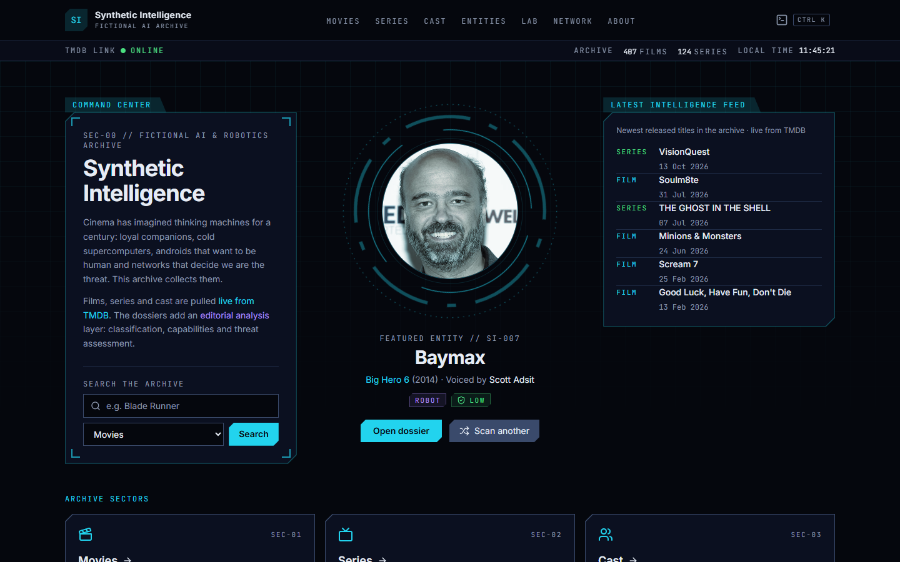
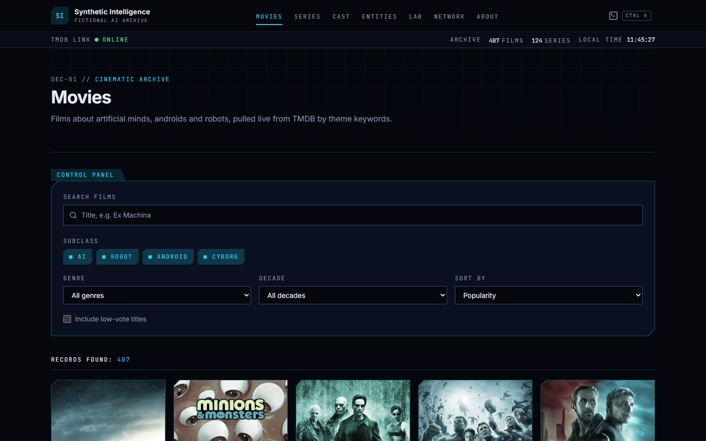
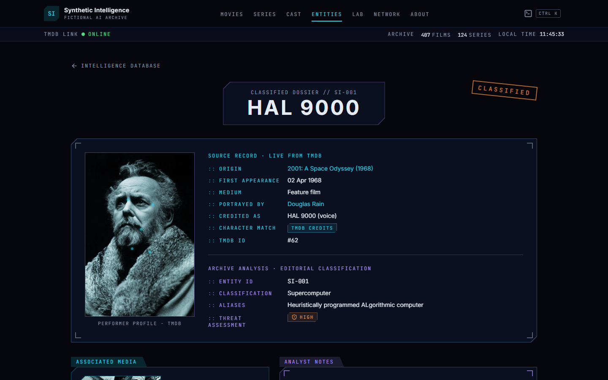
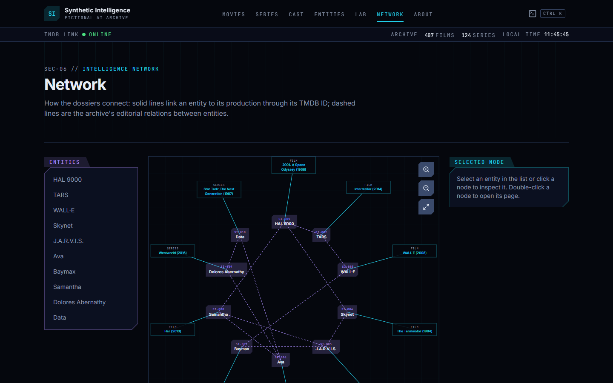
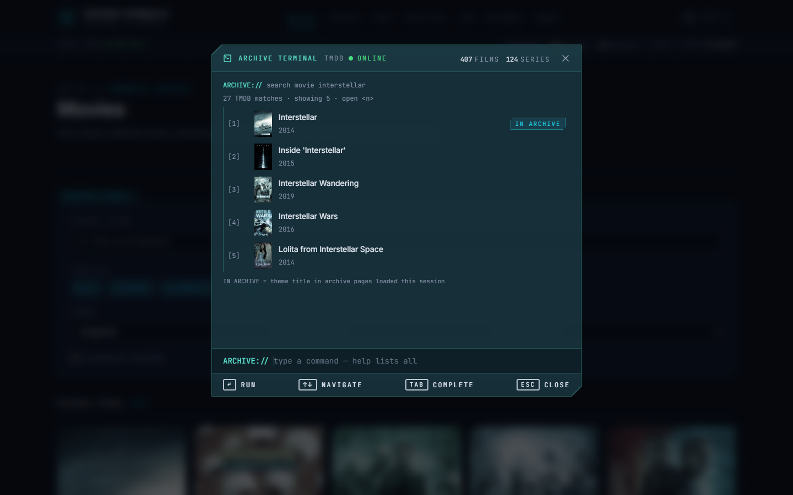
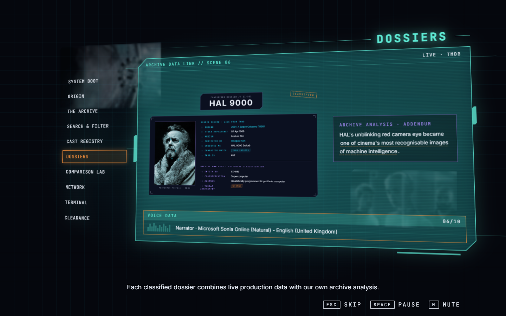
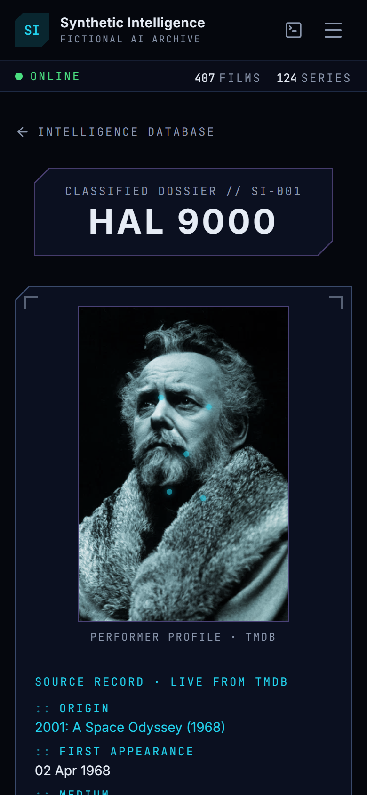

# Synthetic Intelligence — Fictional AI & Robotics Archive

An interactive wiki of the artificial intelligences, androids and robots of film and television,
styled as the archive terminal of a classified research institute.

**Live site:** https://synthetic-intelligence-khaki.vercel.app/
**Repository:** https://github.com/IremXErkan/synthetic-intelligence

SE 3355 Web Programming — Midterm Project. Built with **React** and **Tailwind CSS** on top of the
public **TMDB API**.



---

## The idea in one sentence

**Every film, series and person on the site comes live from TMDB; the project adds a clearly
labelled editorial analysis layer on top of it.**

This is a *theme* wiki (the assignment allows "a universe, collection or theme"): instead of a fixed
list, the archive is built from TMDB keywords, so it contains hundreds of real titles — at the time
of writing **407 films and 124 series** (the numbers on the site are always the live
`total_results` from TMDB, never hard-coded).

---

## Features

### Pages

| Route | Page | Data |
|---|---|---|
| `/` | **Command Center** — theme intro, global search, featured dossier, latest titles, live archive counts, section cards | TMDB + editorial |
| `/movies` | **Cinematic Archive — Movies** (list 1) | TMDB |
| `/series` | **Cinematic Archive — Series** (list 2) | TMDB |
| `/cast` | **Cast Registry** (list 3) — actors and voice actors compiled from the archive's credits | TMDB |
| `/entities` | **Intelligence Database** — the dossier catalog | editorial + TMDB |
| `/media/:type/:id` | **Media Detail** — backdrop, poster, facts, cast, trailer, related dossiers, recommendations | TMDB |
| `/person/:id` | **Person Detail** — profile, biography, archive roles highlighted in the filmography | TMDB |
| `/entity/:slug` | **Classified Dossier** — live production record + labelled archive analysis | TMDB + editorial |
| `/lab` | **Comparison Lab** — two entities side by side, radar chart and score bars | editorial + TMDB |
| `/network` | **Intelligence Network** — graph of entities, productions and their relations | editorial + TMDB |
| `/about` | Methodology, data sources, TMDB attribution | — |
| `*` | Themed 404 — "File not found" (also used for invalid IDs, slugs and media types) | — |

### Lists, search and filters
- **Theme lists from the API:** `/discover/movie` and `/discover/tv` with 17 verified keyword IDs in
  four groups (AI, Robot, Android, Cyborg) combined with OR.
- **Search** (debounced) switches to TMDB's `/search` endpoints and marks results that are part of
  the loaded archive with an *In archive* badge.
- **Filters:** subclass (each keyword group can be switched off), genre, decade, sort order
  (popularity, rating, release date) and an option to include low-vote titles.
- **All filter and search state lives in the URL** (`useSearchParams`): links are shareable and the
  back button works.
- **Load more** on all three API lists.
- **Cast Registry:** credits of each loaded production are fetched in parallel (cached), merged, and
  the same actor appears once with all of their roles. A *Probable synthetic characters only* toggle
  is a heuristic filter, and the page says so.

### States
Every request has a themed **skeleton loading** state, an **error** state with a *Retry* button and
an **empty** state. A live **TMDB link indicator** in the status bar shows whether the API answers.

### Extras
- **Boot Sequence intro** — a ~75-second narrated tour on the first visit to `/` (direct links skip
  it; *Replay intro* in the footer). It uses the site's real components with live TMDB data. The
  narration is a recorded voice (generated with ElevenLabs, files in `public/narration/`), so
  everyone hears the same narrator; if a file cannot play it falls back to the browser's own
  speech engine, then to captions only. Captions are always shown. **Esc** skips, **Space**
  pauses, **M** mutes.
- **Archive Terminal** — a command palette opened with **Ctrl+K** (or the terminal button in the
  navbar). A fixed command set (`help`, `goto`, `search`, `open`, `dossier`, `dossiers`, `compare`,
  `stats`, `status`, `clear`, `exit`) with live, grouped suggestions, Tab completion and command
  history. No AI: unknown input simply returns `unknown command — type help`.
- **Comparison Lab** with a Recharts radar chart; the URL keeps the selection
  (`/lab?a=hal-9000&b=tars`).
- **Intelligence Network** built with React Flow; solid edges are TMDB links, dashed edges are
  editorial relations, and a legend explains both.
- **Responsive** down to 375 px (hamburger menu, full-screen terminal on phones).
- **Accessible:** semantic HTML, visible focus, skip link, keyboard navigation, focus trapping in
  dialogs, `aria-live` updates, threat levels shown with text and icon (never colour alone), and
  `prefers-reduced-motion` respected everywhere.

---

## Two data layers

| | TMDB layer | Editorial layer |
|---|---|---|
| **What** | Films, series, people, posters, backdrops, dates, genres, credits, trailers, recommendations | Entity type, capabilities, threat level, 1–10 comparison scores, relations between entities |
| **Where** | Fetched live through `src/services/tmdb.js` | `src/data/entities.js` — 10 hand-written dossiers |
| **In the UI** | Labelled "live from TMDB" | Always in a separate, purple box labelled **Archive Analysis / Editorial Classification** |

Rules the project follows:
- The editorial catalog stores **only TMDB IDs** and analysis fields. Titles, images, years and
  actors of a dossier are always loaded live from TMDB.
- Every TMDB ID and credited character name in the catalog was checked against the API.
- Scores are a **subjective project assessment**, not a measurement; the Lab and About pages say so.
- No fake data: if a request fails, the page shows an error state instead of placeholder content.

### Why two layers
- **TMDB has the facts but not the theme.** It knows titles, casts and release dates, but it has no
  field such as "entity type" or "threat level", and no way to compare HAL 9000 with TARS. That
  analysis has to be written by hand, so it lives in its own small catalog.
- **Keeping them apart keeps the site honest.** Live data is never mixed with opinion: a reader can
  always tell which numbers come from TMDB and which are the project's own judgement.
- **The catalog stays small and correct.** Because it stores only IDs, nothing in it goes out of
  date — posters, titles and cast always come from the current TMDB record.

### How the theme is defined
`src/config/themeKeywords.js` holds the keyword IDs, each one looked up with `/search/keyword` and
checked with `/keyword/{id}` (several noisy keywords were rejected and are listed in the file).
To reduce noise, lists use a minimum vote count of 50 (switchable in the filters), and the series
list excludes TMDB's *Kids* genre.

### TMDB API endpoints used

All requests go to [TMDB API v3](https://developer.themoviedb.org/docs/getting-started) with
`language=en-US` (and `include_adult=false` on lists); every endpoint was checked with a real request before it was used.

| Endpoint | Used for |
|---|---|
| `GET /discover/movie`, `GET /discover/tv` | Theme lists (keyword filter, genre, decade, sort, pages), archive counts |
| `GET /search/movie`, `GET /search/tv` | Search on the list pages (the home search box opens them) and in the terminal |
| `GET /movie/{id}`, `GET /tv/{id}` + `append_to_response` | Detail pages: `credits` (films) / `aggregate_credits` (series — plain TV credits only cover the latest season), `videos`, `recommendations`, `keywords` |
| `GET /movie/{id}/credits`, `GET /tv/{id}/aggregate_credits` | Cast Registry |
| `GET /person/{id}` + `combined_credits` | Person page |
| `GET /genre/movie/list`, `GET /genre/tv/list` | Genre filter |
| `https://image.tmdb.org/t/p/{size}{path}` | Posters, backdrops and profile photos |

`/search/keyword` and `/keyword/{id}` were used once, during development, to find and verify the
theme keyword IDs.

---

## Screenshots

| Movies — filters in the URL | Classified Dossier |
|---|---|
|  |  |

| Comparison Lab | Intelligence Network |
|---|---|
|  |  |

| Archive Terminal (Ctrl+K) | Boot Sequence intro |
|---|---|
|  |  |



---

## Tech stack

- **React 19** (function components and hooks only) with **Vite 8**, plain JavaScript
- **Tailwind CSS 4** — the only styling solution; no UI kit or template
- **React Router 8** — client-side routing, code-split pages
- **fetch** — no HTTP library
- **Framer Motion** — short page and panel transitions
- **Recharts** — Comparison Lab radar chart
- **React Flow** (`@xyflow/react`) — Intelligence Network
- **lucide-react** — icons
- **Vitest** + **Testing Library** — tests; **ESLint** — linting

No global state library: component state, props and URL query parameters are enough.

---

## Getting started

### Requirements
- A current **Node.js** LTS release with npm (developed with Node 26)
- A free **TMDB account** and its **API Read Access Token**
  (themoviedb.org → Settings → API)

### Setup

```bash
git clone https://github.com/IremXErkan/synthetic-intelligence.git
cd synthetic-intelligence
npm install
```

Create a `.env` file from the example and paste your token after the `=`:

```bash
cp .env.example .env              # macOS / Linux / Git Bash
Copy-Item .env.example .env       # Windows PowerShell
```

```
VITE_TMDB_READ_TOKEN=your_tmdb_read_access_token
```

Then start the dev server:

```bash
npm run dev
```

> **Note on the token:** variables prefixed with `VITE_` are bundled into the client-side JavaScript,
> so the token is visible in the browser. That is acceptable for a course project using a free,
> read-only TMDB token; a production app would call TMDB through its own backend.
> `.env` is listed in `.gitignore` and is never committed.

### Scripts

| Command | What it does |
|---|---|
| `npm run dev` | Development server with hot reload |
| `npm run build` | Production build into `dist/` |
| `npm run preview` | Serves the production build locally |
| `npm run lint` | ESLint |
| `npm test` | Runs the test suite once |
| `npm run test:watch` | Tests in watch mode |

---

## Project structure

```
src/
├── components/
│   ├── layout/     Navbar, Footer, StatusBar (live TMDB status and archive counts)
│   ├── common/     HudPanel, Skeleton, ErrorState, EmptyState, SearchBar, FilterBar, Badge, Redacted, …
│   ├── home/       Command Center sections
│   ├── media/      MediaCard, MediaArchive (shared by /movies and /series), CastList
│   ├── entity/     EntityCard, DossierFile, ScoreBars, LabRadar, NetworkCanvas, …
│   ├── person/     PersonCard
│   ├── intro/      Boot Sequence (lazy-loaded): stage, narration, scenes
│   └── terminal/   Archive Terminal (lazy-loaded): panel, commands
├── pages/          One component per route
├── services/       tmdb.js (all TMDB requests), catalog.js, cast.js
├── hooks/          useFetch, useDebounce, useArchiveQuery, useTmdbStatus, …
├── config/         themeKeywords.js (verified keyword IDs), archive filters
├── data/           entities.js (editorial catalog)
├── utils/          imageUrl, media helpers, cast compiler, network graph
├── App.jsx         Routes, intro and terminal
└── main.jsx
```

Components never call `fetch` themselves; every request goes through `src/services/`.

### Under the hood
- **Request layer** (`services/tmdb.js`): in-memory cache of response promises (the same URL is
  requested once, parallel identical requests are shared), at most 6 requests in flight at a time,
  readable error messages, and a live connection status.
- **`useFetch`** runs requests with an `AbortController`, so leaving a page or changing a filter
  cancels the old request and never sets state after unmount.
- **Image URLs** are built in one helper from TMDB's verified base URL and sizes; missing images get
  a themed placeholder.
- **Code splitting:** pages, the intro, the terminal, Recharts and React Flow are separate chunks.

---

## Testing

75 tests in 11 files (Vitest + Testing Library, jsdom):

- theme keyword filter and archive filter parsing
- image URL and media helpers
- cast compiler (merging and de-duplicating actors, the synthetic-character heuristic)
- network graph builder
- `useFetch` (loading, error, retry, abort) and `useArchiveQuery`
- common components (threat badge, error state with retry, redacted text)
- intro narration engine (recorded files, voice choice, timing, pause, playback errors)
- Archive Terminal commands and suggestions (TMDB calls mocked)

```bash
npm test
```

---

## Deployment

Deployed on **Vercel** from the `main` branch.

- `VITE_TMDB_READ_TOKEN` is set in the Vercel project's environment variables.
- `vercel.json` rewrites every path to `index.html`, so refreshing or opening a deep link such as
  `/entity/hal-9000` works instead of returning 404.

---

## Attribution


This website uses TMDB and the TMDB APIs but is not endorsed, certified, or otherwise approved by TMDB.
All film, series and person data and images are provided by
[The Movie Database (TMDB)](https://www.themoviedb.org/).

The scope is fictional AI in **films and series** only. The dossier texts, classifications and scores
are the project's own editorial work.
